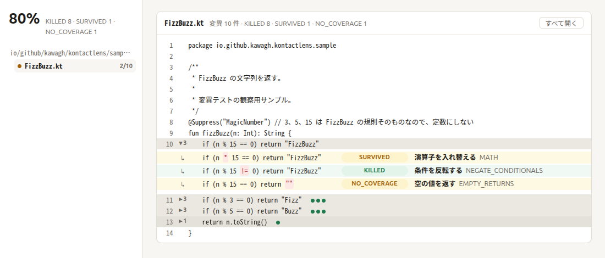
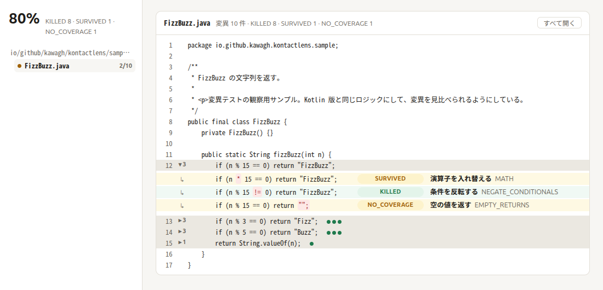

# kontactLens

[PIT](https://pitest.org/) の変異テストの結果を、ソースコードと並べて見せる HTML レポートを作ります。

> [!NOTE]
> 実験的なプロジェクトです（0.x）。レポートの表示や API は、今後のバージョンで互換性なく変わることがあります。

- ソースを全文表示し、変異した行の下に「変異後の行」と「検出結果（KILLED / SURVIVED / NO_COVERAGE）」を並べます。
- 変異後の行は、PIT の mutator と説明文から推定しています（PIT はソース上の変化を記録しないため）。
- Kotlin と Java、Kotest と JUnit のプロジェクトに対応しています。



<details>
<summary>Java のプロジェクトのレポート</summary>



</details>

## 動作環境

| | 対応範囲 | テストしている版 |
| --- | --- | --- |
| Gradle | 9.0 以上 | 9.0.0、9.5.1 |
| JDK（Gradle を動かす JDK） | 17 以上 | 17、21、25 |

PIT は 1.30.1、gradle-pitest-plugin は 1.19.0 で確認しています。gradle-pitest-plugin 1.19 自体も、Java 17 以上を必要とします。

## 使い方

Gradle プラグインとして使います。PIT（[gradle-pitest-plugin](https://github.com/szpak/gradle-pitest-plugin)）を使っているプロジェクトに、`+` の行を追加します。

まだ Gradle Plugin Portal には公開していないため、このリポジトリを clone して `includeBuild` で読み込みます。

```diff
 // settings.gradle.kts
 pluginManagement {
+    includeBuild("path/to/kontact-lens")
     repositories {
         gradlePluginPortal()
     }
 }
```

kontactLens は PIT の XML のレポートを読むので、PIT の設定にも 2 行追加します。

```diff
 // build.gradle.kts
 plugins {
     kotlin("jvm") version "2.3.20"
     id("info.solidsoft.pitest") version "1.19.0"
+    id("io.github.kawagh.kontactlens")
 }

 pitest {
     targetClasses = setOf("com.example.*")
+    outputFormats = setOf("XML")
+    timestampedReports = false
 }
```

Java のプロジェクトでも、追加する行は同じです。`java` プラグインの `src/main/java` からソースを読みます。

```diff
 // build.gradle.kts（Java のプロジェクト）
 plugins {
     java
     id("info.solidsoft.pitest") version "1.19.0"
+    id("io.github.kawagh.kontactlens")
 }
```

PIT 標準の HTML レポートも出したい場合は、`outputFormats = setOf("XML", "HTML")` にします。

```sh
./gradlew kontactLensReport
```

`pitest` の後に実行され、`build/reports/kontactlens/index.html` に出力されます。

### テストフレームワークごとの PIT の設定

kontactLens 自体の設定ではありませんが、PIT がテストを実行するには、テストフレームワークに合わせたプラグインが必要です。設定例は [`samples/`](samples) にあります。

JUnit 5 以降（JUnit 6 を含む）の場合:

```diff
 pitest {
+    junit5PluginVersion = "1.2.3"
 }
```

Kotest の場合は、Kotest 公式の PIT プラグインを使います。

```diff
 dependencies {
+    pitest("io.kotest:kotest-extensions-pitest:6.2.6")
 }
```

## 制限

変異後の行は推定なので、次の場合は正しく表示されないことがあります。

- 1 行に同じ演算子が複数あるときは、最初のものが変わったとみなします（例: `a >= 0 && b >= 0`）。
- 前後に空白の無い演算子（例: `a+b`）は推定しません。
- 推定に対応していない mutator（`VOID_METHOD_CALLS` など）や、Kotlin の式本体の関数（`fun f() = ...`）の戻り値の変異は、PIT の説明文をそのまま表示します。
- inline 関数を展開した箇所の変異は、ソースに存在しない行番号になります。これらはファイルの末尾にまとめて表示します。

## サンプル

`samples/` に、同じ FizzBuzz を Kotlin + Kotest、Kotlin + JUnit、Java + JUnit で書いたプロジェクトがあります。15 の倍数をわざとテストしていないため、SURVIVED と NO_COVERAGE の変異を観察できます。

```sh
./gradlew sampleReports  # lib/build/reports/kontactlens/ にサンプルごとのレポートを出力
```

## 開発

```sh
./gradlew build                   # テスト、detekt、依存ライブラリのライセンス検査（Licensee）を含むビルド
./gradlew detekt --auto-correct   # コードの整形
./gradlew dokkaGenerate           # KDoc から API ドキュメントを生成（build/dokka/html）
```

| ディレクトリ | 内容 |
| --- | --- |
| `lib/` | PIT の `mutations.xml` の読み込みと、HTML レポートの生成 |
| `gradle-plugin/` | Gradle プラグイン（`kontactLensReport` タスク） |
| `samples/` | 変異を観察するためのサンプル |

## ライセンス

[MIT](LICENSE)
